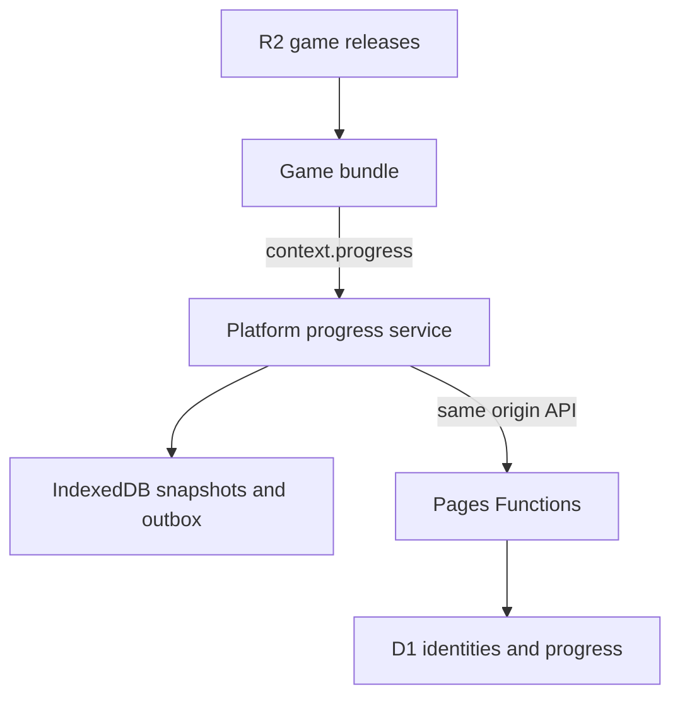

# Anonymous game progress design

## Current decision: single-device progress with transfer

On 2026-10-14 the product direction changed to **local storage by default and
explicit account transfer**. No automatic multi-device synchronization or
permanent cloud save is required. The replacement design is
[Local progress and account transfer](account-transfer.md).

The replacement is now implemented locally; it has not been deployed. The
synchronization flow and API descriptions below are historical. Their code has
been removed, old routes return 410, and migration 0005 dropped the tables. Do not use the historical deployment
instructions to reactivate synchronization.

### Review findings in the current implementation

Local fault-injection against the real client and D1/workerd reproduced:

| Severity | Trigger and result | Relevant implementation |
| --- | --- | --- |
| P1 | A conflict-branch upload commits but its reply is lost; play advances from 10 to 20 before choosing local progress. Resolution selects cloud branch 10 while acknowledging local sequence 20. Reload restores 10 and loses the newer progress. | `site/progress/client.js` `preserveConflict` / `resolveConflict`; `server/progress.js` branch selection. |
| P2 | Opening a valid connection link automatically switches an already-bound browser into the sender's account. Its subsequent play is visible to the sender; the previous profile remains separate. | `site/play/player.js` connection startup; `server/progress.js` `session/connect`. |
| P2 | A second game has pending local progress, but a link is created while the first game is open. Only the current game uploads; the other remains absent on the receiving device. | `site/progress/client.js` `performSync` / `createLink`. |
| P2 | A single-device visitor saves once and never returns. Expiring all sessions and running housekeeping leaves the account and save indefinitely. | `server/store.js` `housekeeping`. |
| P2 | Reset requests for arbitrary unregistered game IDs create zero-payload tombstones. Twelve test IDs created twelve rows while the payload quota counted zero bytes. | `server/progress.js` reset routing; `server/store.js` quota accounting. |

The existing 44 tests passed during the review; they do not cover these combined
failure cases. No production data was used for the reproductions. The replacement removes these obsolete paths and has dedicated tests for
immutable packets, explicit acceptance, complete-profile transfer, and bounded
retention. The old 44-test count is historical, not the new validation total.

## Historical synchronization design (superseded)

Legacy status: implemented and tested locally, with the review failures above.
Production D1 and Pages bindings are
configured; the updated website and cloud synchronization have not been deployed.
The runtime remains [API v1](game-bundles.md), with optional `context.progress`.
The default build uses IndexedDB only. Explicit cloud builds add Pages Functions,
D1, a functional anonymous session Cookie, and optional recovery codes.
See [README](../README.md#local-transfer-preview) for commands and activation steps.

Implementation: `site/progress/` owns browser storage, queue, and UI;
`server/progress.js` implements the API; `migrations/` defines D1 storage.
Wooden Fish 1.1.0 (a game since abandoned) integrated the capability; 1.0.0 remained unchanged.
The main My progress action is a one-use device connection link; backup codes,
manual sync, export/import, and deletion are inside More options. Failures mark
the menu button with `!` and an accessible status label. The game keeps its viewport.
Housekeeping runs in bounded batches on account creation and daily session
renewal; 30-day retention is an eligibility threshold, not a precise erasure
schedule. Sessions renew during an authenticated startup check or when a save needs syncing. An offline reset that meets
a newer head requires explicitly resetting again after reconnecting; it never
silently rebases deletion. Browser checks use local workerd/D1, not production.
The tables below specify behavior and acceptance requirements; their scenarios
are not a claim that every operating-system/browser crash has been tested.

The normal experience is: open a game, play, return later, continue. Recovery,
conflict resolution, export, and deletion live in the player's **My progress /
我的进度** menu. Identity is hidden from the ordinary flow; saving failures are
visible. A browser profile represents one player, not a verified person.

## Decisions from review

| Gap in the initial proposal | Decision |
| --- | --- |
| A late cloud read can overwrite a game that has already started. | Choose the starting snapshot before creation. Later reads cannot replace a running game's state. |
| A changed Cookie can send an old queue to a different account. | Partition local data by owner and require a server-checked expected account on every authenticated request. |
| A revision alone does not make retries safe. | Commit the revision change, previous snapshot, and operation receipt atomically. Retry immutable requests with the same operation ID. |
| The game scope aborts during restart and navigation. | The platform owns persistence beyond the game scope. Accepted local saves survive game disposal. |
| Two tabs can lose updates in shared IndexedDB before reaching the server. | Fence local writers with a transactional generation counter; cloud revision checks remain necessary. |
| Recovery code replacement can lock someone out if its response is lost. | Keep the previous code valid until the player confirms saving the new code. |
| Deleting a row allows an old device to recreate it. | Keep a versioned tombstone and require an explicit reset transition. |
| A generic JSON platform cannot safely merge arbitrary game state. | Preserve conflicts and ask which branch to continue. No generic sum, maximum, or timestamp winner. |

## Experience and guarantees

All controls follow [DESIGN.md](../DESIGN.md): mobile menu, Chinese and English,
visible focus, 44px touch targets, and plain status text. Opening a progress
dialog pauses gameplay and restores the previous pause state when closed.

| Situation | Behavior |
| --- | --- |
| First ordinary visit | No registration prompt. Create a cloud identity lazily when the first meaningful local save needs uploading. |
| Return in the same browser | Verify the session, select the saved state, and resume. |
| Connection lost during play | Keep saving locally. Retry synchronization when the page is active and the service is reachable. |
| Another device | Open a private one-use link from an already connected device; obtain a separate session automatically. An optional backup recovery code also works. |
| Cookie missing but local progress remains | Continue locally; offer recovery or an explicit new identity. Never silently move the old queue. |
| Browser storage was cleared | A recovery code can retrieve cloud saves. Without any credential, the old identity cannot be recovered. |
| Local storage fails | Show “Progress is not saved / 进度暂未保存”, retain the current state in memory, and offer export. |
| Concurrent progress | Preserve both alternatives and offer a choice at a paused boundary. |

Use distinct statuses: **Saved on this device / 已保存在本机**, **Synced /
已同步**, **Recovery needed / 需要恢复**, **Choose progress / 选择进度**, and
**Not saved / 尚未保存**. “Synced” means the cloud acknowledged the latest local
sequence, not merely an earlier request. A conflict copy in the cloud is backed
up but is not the selected synchronized state.

Explain automatic storage briefly in the menu, with one primary action to connect
another device. On focus or reconnection, refresh a clean local game automatically;
preserve dirty local progress and ask only for genuine divergent edits. Identical
JSON checkpoints acknowledge the matching cloud head without asking for a choice. A recovery
code is optional; it provides access to progress and must be kept private.

Offline saving applies to an already loaded game. This implementation does not add a
service worker or guarantee loading the site and all game assets offline.
Browser storage can be cleared or unavailable, and a terminated page may lose
work not yet committed. Never promise that every last input survives a crash.
[IndexedDB shutdown behavior](https://developer.mozilla.org/en-US/docs/Web/API/IndexedDB_API/Using_IndexedDB#warning_about_browser_shutdown)
is why saves happen during play rather than only at exit.

## Ownership and architecture

| Owner | Responsibilities |
| --- | --- |
| Game | Choose checkpoints; validate and migrate its JSON; apply the selected snapshot; catch save errors. |
| Player | Bind the catalog game ID; select starting state; show progress controls; coordinate restart, recovery, and reset. |
| Progress service | Local transactions, writer fencing, identity partitions, network queue, retries, and conflict preservation. |
| Pages Functions | Authenticate, authorize, enforce limits, and commit conditional mutations. |
| D1 | Authoritative account state, sessions, credentials, revisions, receipts, and saved payloads. |

Keep HTML/CSS/JavaScript and R2 game publishing as they are. Add only same-origin
`/api/*` Pages Functions and a D1 binding for explicitly enabled cloud builds.
[Pages Functions supports D1 bindings](https://developers.cloudflare.com/pages/functions/bindings/#d1-databases).

Use D1's primary database for all initial identity and save operations; do not
enable replica reads in the first release. D1's ordinary binding queries use
the primary; read replication requires the Sessions API. If replication is
introduced later, separately specify bookmarks and fresh authorization reads.
[D1 read consistency](https://developers.cloudflare.com/d1/best-practices/read-replication/)

R2 remains asset storage. KV is not the save authority because its
[eventual consistency](https://developers.cloudflare.com/kv/concepts/how-kv-works/)
does not provide the conditional update semantics needed here. Durable Objects,
an event log of every input, and automatic game-specific merging are outside
the first release.

## Identity and recovery

### Credentials

Generate a random account ID and a separate session for each browser profile.
The account ID is an identifier, never proof of ownership. Use a public session
ID plus a 256-bit cryptographically random secret; store only its SHA-256
verifier. Authenticate against an active, unexpired session and active account.
Use a constant-time verifier comparison. These choices follow
[OWASP session guidance](https://cheatsheetseries.owasp.org/cheatsheets/Session_Management_Cheat_Sheet.html).

The cloud-mode Cookie is `__Host-fun_session`, with `Secure`, `HttpOnly`,
`SameSite=Lax`, `Path=/`, and no `Domain`. This keeps it away from game asset
subdomains. `HttpOnly` prevents reading the credential from JavaScript; it does
not prevent same-origin scripts from making authenticated requests.
[Cookie attributes](https://developer.mozilla.org/en-US/docs/Web/HTTP/Reference/Headers/Set-Cookie)

Use a 180-day inactivity lifetime initially, renewed at most once per day by the
session endpoint. Enforce expiry on the server as well as in the Cookie. This
is a proposed product setting, not a guarantee about browser retention. Do not
rotate or reissue credentials on every save response. Revocation is immediate
at the next authorization check; recovery issues a separate session.

### Startup and identity changes

Local metadata records `guest`, `bound(accountId)`, or `recovery-required`, plus
an `identityGeneration`. A guest bucket is only local storage, not a credential.
The non-secret binding marker survives a missing Cookie if IndexedDB remains.
If both are erased, a new browser cannot be distinguished from a new person.

1. Read local metadata and probe the session when opening a save-enabled game.
   Network failure is unknown identity, not an instruction to create an account.
2. A never-bound guest may bootstrap a new identity after a meaningful local
   save. Serialize Cookie-changing requests across tabs using Web Locks and
   recheck the session inside the lock. Verify the resulting session in a
   subsequent request before binding or uploading. A lost bootstrap response may
   leave an empty account, but must not move data. If the verification still has
   no Cookie, enter local-only mode instead of repeatedly creating accounts.
3. An invalid or absent session for a previously bound bucket suspends upload.
   Keep local play and export available. Creating a replacement account requires
   an explicit choice; old progress stays separate until explicitly imported.
4. On restore, pause the game, stop new saves, finish accepted local transactions,
   and persist a pending identity transition with a random operation ID before
   sending the recovery code. Preserve the source bucket and its queue. Do not
   merge anonymous accounts.
5. After the server switches the session, verify it, update the binding and
   generation in one local transaction, and recreate the game from the target
   account's selected save. Revoke the replaced browser session when switching
   accounts; other devices' sessions are unaffected.
6. If a response is lost or the page crashes during the transition, probe the
   session on reopening. A restored session carries the transition's operation
   ID, allowing discovery to confirm that this specific switch succeeded. If it
   cannot be confirmed, keep upload suspended and retry recovery; never attach
   data merely because a different account appeared in the Cookie. A timeout
   does not mean the server made no change.

Account-scoped requests carry an `expectedAccountId`. The server derives
ownership from the Cookie and rejects a mismatch; that field never grants
access. Session discovery is the exception: it returns only the current identity
and capability flags so a browser can establish this expectation. Restore
checks the expected source session and derives the target account from the
recovery credential. The client also captures its local generation on dispatch
and ignores late responses for a different binding. Old tabs must stop uploading
on a mismatch and reload the selected identity before continuing.

Web Locks coordinate Cookie changes; IndexedDB transactions enforce local
ownership. Notifications through BroadcastChannel are only a convenience, not
a correctness mechanism. If browser coordination is unavailable, retain local
play and export and mark cloud synchronization unavailable rather than inventing
an unsafe locking fallback. [Web Locks](https://developer.mozilla.org/en-US/docs/Web/API/Web_Locks_API)
provides same-origin coordination across tabs.

### One-use device connection links

`POST /api/session/link` creates a random 256-bit token, stores only its hash,
and replaces the previous link issued by this browser session. It expires after
10 minutes and is revoked when its source session is revoked or expires.
The player copies a `/games/<id>#connect=...` URL. Treat the link as private:
whoever opens it can connect. There is no third-party link/QR service.

A blocking first-party script removes the fragment from browser history before
modules or analytics run. The token stays only in memory until it is submitted
to `POST /api/session/connect`; it is never persisted in browser storage.
Opening the link explicitly authorizes the identity switch. The target pauses
before starting the game, stores a pending transition ID, and atomically consumes
the link while creating its session. The source remains connected. Previous
local profiles remain separate and exportable. A subsequent probe confirms the
Cookie and transition before loading progress; concurrent redemption succeeds
once. A lost response can be reconciled with the transition marker when the
Cookie arrived, or a new link can be generated on the original device.

### Recovery code lifecycle

Use a random 160-bit recovery secret encoded as grouped base32 with a version
and typo-detection checksum. The checksum adds no security. Store only its hash;
never put the secret in URLs, logs, analytics, or ordinary save exports.

Generating a code creates a pending credential with a 10-minute confirmation
window. Display the secret once and let the player copy or download it. Confirming
“I saved it / 已保存” atomically activates it and invalidates the previous code.
An interrupted generation leaves the old code valid; a lost secret can be
replaced by another pending code. If activation's response is lost, the current
session can query the pending credential's activation status without retrieving
the secret. Concurrent activation attempts are guarded by credential revision.

Restoring with the active code issues a new session; the code remains usable
until replaced or revoked. Code verification, active credential revision, and
session creation are checked in the same database transaction, so a concurrent
revocation cannot issue a new valid session afterward. Provide session listing,
revoke-one, and revoke-all-other-sessions in the menu. Replacing the code does
not silently revoke devices; offer that action alongside replacement.

A valid code confers account control. Without email or another independent
credential, the platform cannot adjudicate ownership after code theft. Keep
recovery optional and do not imply verified identity or end-to-end encryption.

## Save model and game contract

Start with one `main` slot per stable catalog game ID. The cloud key is
`(account_id, game_id, slot)`, independent of bundle version and release hash.
Game IDs cannot be reused for unrelated games. Device-only preferences such as
sound volume need not participate in shared progress conflicts.

| Record | Required information |
| --- | --- |
| Account | Random ID, creation time, active/deleting state. |
| Session | Session ID, account ID, secret verifier, expiry, last activity, revocation, creating identity transition ID. |
| Recovery credential | Account ID, verifier, pending/active state, revision, confirmation expiry. |
| Save head | Account/game/slot, monotonically increasing revision, live/deleted state, schema version, bundle version, payload, server update time, last operation ID and digest. |
| Operation receipt | Account/game/slot/operation ID, request digest, outcome and resulting revision. |
| Previous snapshot | Save key, revision, validated envelope and payload. |
| Conflict branch | Save key, branch ID, base revision, latest submitted snapshot, branch revision and creation time. |
| Deletion receipt | Hash of an opaque deletion request ID, completion time, and expiry; no account ID, credentials, or payload. |

Local records additionally include the owner bucket, identity generation, writer
generation, local sequence, acknowledged server revision, and synchronization
state. Index reads and writes by account and game; never scan every account to
load one save. Local storage also holds a recoverable pending identity transition
and a writer record for each active slot. Store only JSON; cap the serialized
UTF-8 envelope at 64 KiB.
Reject unsupported values, excessive nesting, malformed envelopes, and invalid
schema versions before either local or cloud commit.

Add an optional `context.progress` capability with its own `version: 1`:

| Method | Contract |
| --- | --- |
| `load()` | Returns a copy of the selected snapshot, a confirmed empty selected branch, or a typed unavailable result. It never maps a read failure to empty progress. |
| `save({ schemaVersion, data })` | Captures and validates the JSON at call time. Resolves with a local sequence only after the snapshot and outbox transaction completes. Rejects storage, quota, or stale-context failures. It does not wait for the network. |

The host selects the branch before game creation; `load()` does not perform a
second independent cloud lookup. Games handle unavailable/invalid data before
enabling input. A temporary branch is empty only after the player has selected
it or the platform has established that no older progress is being replaced.
Save status, reset, export, recovery, and conflict selection belong to the player,
not to game code. Games receive neither session credentials nor account IDs.

Add `context.launchReason` with `open` or `restart` so a game can distinguish
resuming after reload from restarting its current run. Recovery, conflict
selection, and starting after a reset open the selected snapshot with `open`.
Games with unlocks preserve them when handling `restart`; Wooden Fish simply
retained its merit because it had no separate run. Older hosts default to `open`.

Old bundles remain compatible. New bundles feature-detect the capability when
used with an older host and expose session-only play accurately. The current
publisher rejects new manifest fields, so do not add an undeclared persistence
field: capability detection needs no manifest change in the first release.

The game validates its payload and migrates schema versions before play. Keep
the pre-migration snapshot until the new save is committed. Unknown newer
schemas and migration errors preserve the original and disable writes to that
branch; offer reload, export, or an explicitly separate temporary game. Bundle
version rollback must never overwrite a newer schema with defaults.

### Lifecycle and local writers

The current host aborts its scope before calling game cleanup, and all lifecycle
hooks are synchronous. Keep those hooks synchronous. The player owns a progress
service whose local transactions and network queue outlive an individual game.
After game disposal, reject new saves from that context; finish saves accepted
before disposal under their original owner and writer generation.

For a controlled restart, disable new input, drain accepted local saves, then
dispose and create the next game. Report a failed drain rather than claiming
the state was saved. Do not wait for cloud synchronization to restart. Page exit
cannot guarantee draining; persist checkpoints during play and recover the
outbox on the next visit.

Use one active local writer per owner/game/slot. Acquire it in an IndexedDB
transaction with a monotonically increasing writer generation. A second tab
offers “Continue here / 在此继续”; takeover increments the generation. Every
save transaction checks that generation, so a frozen old tab cannot overwrite
the new writer when it wakes. Different games may run in different tabs.

## Loading and synchronization

### Select the initial state

Give the initial cloud lookup a bounded wait, initially 1.5 seconds after the
local store opens. This is a responsiveness target, not a service guarantee.

| Local state | Cloud result | Action |
| --- | --- | --- |
| Clean cached snapshot | Newer compatible cloud revision | Select cloud before creating the game. |
| Dirty snapshot | Same acknowledged base revision | Select local and queue synchronization. |
| Dirty snapshot | Different live revision | Preserve both and resolve a conflict. |
| Cached snapshot | Timeout or network error | Play local; cloud state remains unverified. |
| No snapshot | Confirmed absence in the selected account | Start a new save at base revision 0. |
| No snapshot | Cloud or identity unknown | Retry or explicitly start a separate local branch; do not treat this as cloud absence. |
| Any old snapshot | Cloud tombstone | Block ordinary upload and explain deletion; only an explicit new-start/import can write after it. |

A response arriving after game creation may update status or cache an
alternative. It cannot patch live game state. A dirty game uses conflict
handling; a clean game can adopt a newer snapshot only by a controlled restart
at a paused boundary. Becoming visible again rechecks session and revision.

### Local transaction and outbox

Commit the snapshot, next local sequence, and outbox intent together. A browser
request's success event is insufficient; wait for the transaction's completion.
The outbox is scoped to its original owner, slot, and branch.

Only one logical cloud mutation per slot may be in flight. Claim its immutable
body, base revision, operation ID, and request digest in a shared IndexedDB
transaction before dispatch. If its uploader closes, another tab retries that
same record; duplicate attempts have the same operation ID. New gameplay may
update a separate latest-pending snapshot. Never mutate an in-flight request or
reuse its operation ID for different data.

An acknowledgment removes only its matching outbox entry. If gameplay produced
newer local sequences, retain them and advance their base only along the
acknowledged predecessor chain. A cloud read or conflict response cannot merely
replace the base revision and resubmit the same snapshot; that would turn a
conflict into silent data loss.

Coalesce superseded snapshots that have never been dispatched, retaining their
original cloud ancestry. An in-flight or uncertain operation is resolved first.
Use a two-second cloud debounce with a 15-second maximum interval while dirty;
checkpoints and pause can request an earlier attempt. Local saves are not held
until that timer. Retry network errors and 5xx with exponential backoff and
jitter; honor `Retry-After` on 429. A 401 suspends synchronization; 409 enters
the transition identified by its machine-readable error code. Only a revision
conflict enters branch handling; malformed/oversized data requires repair, not
endless retry.

### Server commit and uncertain responses

Each write includes the expected account, game/slot, base revision, operation
ID, schema version, and captured data. The server checks the allowed game ID,
session, quota, envelope, and owner. Authorization must still be valid inside
the commit transaction, including concurrent session revocation or deletion.
Quota checks and byte accounting share that transaction, so simultaneous games
cannot each spend the same remaining account allowance.

The transaction performs a conditional update only when the existing revision
equals the base, records the previous snapshot, and records the operation result.
Creation uses base 0 and a unique key, so concurrent creation cannot overwrite.
The server increments the revision; client clocks never determine the winner.

If an existing receipt has the same ID and digest, return its recorded result
without another write. A different digest with that ID is rejected. Lost
responses therefore retry safely. Never implement the revision check as an
unprotected JavaScript read followed by an unconditional update.

D1's `batch()` supports transactional prepared statements. Design its SQL guards
so a zero-row conditional update cannot still record a successful receipt or
advance history; zero affected rows are not an SQL error. The account state,
write precondition, and dependent inserts must share the same transaction.
[D1 batch semantics](https://developers.cloudflare.com/d1/worker-api/d1-database/#batch)

Keep receipts for 30 days and retain the head's last operation ID and digest
after receipt cleanup. An older retry whose outcome is no longer known can
only run with its original revision precondition. If stale, retain it as an
unresolved branch and reconcile; never rebase automatically. Revisions, including
tombstones, are never recycled, so pruning receipts cannot make an old write
apply a second time.

### Conflict resolution

For two devices starting at revision 8, the first accepted save becomes 9. The
other receives a structured 409 containing current metadata. Its pending data
remains local; the platform attempts to store a conflict branch separately with
an idempotent request. Until that succeeds, label the alternative “on this
device”. Creating a conflict copy never updates the canonical head.

Allow at most two unresolved cloud branches per game initially. Do not evict an
unresolved branch to make room; keep excess alternatives local and offer export.
A branch has its own revision so updating a preserved alternative is conditional
and retryable too. Keep timestamps as explanatory labels, not ordering proof.

At a paused boundary, let the player choose the current cloud snapshot or the
local branch. Freeze input and finish accepted local saves before capturing the
choice's local sequence and writer generation. No selection means local play
may continue and the canonical upload stays suspended. Selection is an explicit
mutation against the displayed head and branch revisions. Preserve the displaced
snapshot in bounded history; mark a branch resolved only in the same transaction
as selection. Another device writing during selection causes a fresh conflict
rather than forced overwrite.

Wooden Fish initially used this snapshot policy. If devices independently move
from 100 to 110 and 107, neither 110 nor 217 preserves all distinct knocks. A
future increment protocol would need operation identity, deduplication, and a
reset generation to produce 117 safely; it is not a generic JSON merge rule.

## Reset and deletion

“Restart / 重新开始” recreates the game while retaining long-term progress.
“Reset progress / 清空进度” is a separate confirmed action. A game with both a
current run and unlocks decides what restarting that run means in its payload.

Reset uses a conditional tombstone mutation. Preserve the monotonically
increasing head revision but erase payload, previous snapshots, and conflict
copies for that game. A fresh start explicitly acknowledges the tombstone's
revision and creates the next live revision. Ordinary saves cannot transition a
tombstone to live state. Old queued operations receive a deleted/conflict result;
they cannot implicitly restore removed data, even after a later new game.

For an offline reset, record the local tombstone intent and stop ordinary
uploads. Any new local game is a separate provisional branch until the reset is
acknowledged. If cloud progress changed first, resolve the deletion conflict
before uploading the new branch. Present “Deletion pending / 待联网删除” until
the server confirms it. Delete receipts retain metadata only, never erased data.

Deleting all cloud progress requires connectivity and valid authentication.
Revoke sessions and recovery credentials, remove saves and receipts, and delete
the account atomically. The client first stores a random 256-bit deletion request
ID locally. The deletion transaction records its hashed receipt without an
account ID or payload, retained for 30 days. A status request presenting that ID
can return only completed or unknown, even after session revocation. This permits
confirmation when the deletion response is lost; missing authentication alone
is not evidence of successful deletion. An expired/unknown receipt is explicitly
unconfirmed, not success.

Missing/deleted accounts cannot accept writes or restore requests. Clear this
browser's corresponding local bucket after confirmed deletion; reconcile an
ambiguous response before offering a new identity.

The platform cannot remotely erase a disconnected device. When it reconnects,
reject its credentials and prevent its queue from uploading; only an explicit
import into a new identity may copy data. “Clear this device” is a separate
action and must not claim to delete cloud data. Document the actual backup
retention before launch, and reapply deletions before serving any restored
database backup.

## API and operational boundaries

These routes are implemented and available when cloud mode is enabled. All account-scoped
requests enforce the expected-account guard; recovery additionally authenticates
the target using its credential. Authentication failures never return another
account's metadata.

| Method and path | Purpose |
| --- | --- |
| `GET /api/session` | Inspect identity and recovery availability without implicitly creating it. |
| `POST /api/session` | Bootstrap a never-bound guest or renew an authenticated session. |
| `POST /api/session/link` and `POST /api/session/connect` | Create and consume a private, expiring device connection link. |
| `POST /api/session/restore` | Explicitly switch this browser using a recovery code. |
| `GET /api/sessions` and `DELETE /api/sessions/:id` | Inspect and revoke the caller's device sessions. |
| `POST /api/recovery` and `POST /api/recovery/confirm` | Create and activate a pending code; `GET /api/recovery` returns status only. |
| `DELETE /api/recovery` | Revoke the active code. |
| `GET /api/progress/:game/main` | Read a live, absent, or deleted head explicitly. |
| `PUT /api/progress/:game/main` | Conditionally save, explicitly start after deletion, or reset with an operation ID. |
| `PUT /api/progress/:game/main/branches/:branch` | Conditionally preserve a conflicting snapshot. |
| `GET /api/progress/:game/main/branches` | List preserved alternatives and revisions. |
| `POST /api/progress/:game/main/resolve` | Select a branch against current revisions. |
| `GET /api/progress/export` | Export the caller's cloud saves without credentials. |
| `DELETE /api/account` | Delete the authenticated account and its cloud progress. |
| `POST /api/account/deletion-status` | Present an opaque deletion request ID to check its result without an account session. |

Responses include stable error codes. `409 identity_mismatch` suspends upload
and rechecks the binding; `409 revision_conflict` preserves alternatives;
`410 progress_deleted` blocks automatic restoration. `409 operation_mismatch`
rejects reuse of an operation ID, and `409 quota_exceeded` keeps data local for
export or cleanup. None of these are interchangeable retry instructions. Only a
successful explicit save read can establish an absent record at revision 0;
an unknown route, HTML error page, or generic 404 cannot establish empty progress.

For all mutations, require exact allowed `Origin`, a custom request header, and
JSON where a body is needed. Reject cross-site requests and unsafe redirects;
do not enable credentialed cross-origin access. `SameSite` alone is not the CSRF
control. Use prepared SQL and emit `Cache-Control: private, no-store` on identity,
save, and error responses. Function handlers set their own response headers.

Validate game IDs against the operator's registry, not a client-supplied URL.
Allow export/deletion of old saves after a game is unlisted; do not delete saves
when removing a catalog entry. A registry failure stops new cloud registration
without discarding local data. Keep production, preview, and local identities
and databases separate; an arbitrary preview origin cannot use production API
credentials or storage.

Initial product limits are 64 KiB per snapshot, two unresolved cloud branches
per game, three previous canonical snapshots, and 10 MiB total saved payload per
account. Previous snapshots may age out after 30 days; unresolved conflicts do
not. Canonical saves do not expire merely because a player is inactive in the
first release. Expired sessions, pending credentials, receipts, and empty
abandoned accounts need bounded housekeeping. These are application defaults,
not Cloudflare limits; tune them from measured operation counts and storage.

Apply separate limits to account creation, recovery attempts, and writes, with
both account-based and short-lived network abuse controls. Do not create an
account per page view, log progress payloads, or add a recurring write for every
frame. If quota is reached, refuse the cloud mutation without deleting local
data or unresolved alternatives. Export stays available. Observe error codes,
request counts, and storage totals without collecting gameplay histories.

Export is a versioned JSON envelope containing game IDs, schema versions, and
snapshots, including unsynced local data when exported from this browser. It
contains no session or recovery secret and grants no account access. Import is
an explicit per-game action validated like an untrusted save; it goes through
normal conflict handling and never silently merges accounts.

Bundles currently execute as trusted page code even when downloaded from R2.
The progress API limits accidental coupling; it is not a security sandbox.
Untrusted third-party games require an isolated execution model before release.
Client-authored progress is not authoritative evidence for competitive scores.

## Implementation sequence and acceptance

1. Add the platform-owned IndexedDB service, owner partitions, writer generations,
   local status, export/import, and the optional runtime capability. Integrate a
   new immutable Wooden Fish release. Keep static preview useful in local mode.
2. Add Pages Functions, D1 schema/migrations, explicit cloud configuration,
   anonymous sessions, conditional writes, receipts, and conflict preservation.
   Default ordinary static preview to local mode; add a separate Functions/D1
   preview command when implementing cloud support.
3. Complete recovery, session revocation, conflict selection, reset/deletion,
   quotas, and the menu. Update the bundle contract, packaged game-development
   Skill, README, and tests together when the capability actually exists.
4. Validate failure scenarios locally and in an isolated preview environment
   before enabling production synchronization. Production deployment, bindings,
   are separate deployment actions; the functional Cookie is enabled only in cloud mode.

The first cloud release includes the recovery and conflict paths; shipping just
automatic uploads does not meet this design. No framework or general account
dashboard is required.

| Acceptance scenario | Required outcome |
| --- | --- |
| Refresh after a locally acknowledged save | Restore that save; retry any pending upload. |
| Crash before/after local transaction completion | Recover either complete transaction state; never a snapshot without its outbox intent. |
| Cloud commits but its response is lost | Same operation retry returns the result without a second revision increment. |
| Save again while a request is in flight | Earlier acknowledgment cannot clear newer local data or claim it is synced. |
| Two devices write the same base or create the first save | One canonical write; preserve the other candidate without blind rebase. |
| Two tabs and a frozen previous writer | Local generation prevents the old tab overwriting shared state. |
| Cookie changes while an old queue or request exists | Expected-account and generation checks prevent cross-account writes. |
| Session missing, expired, revoked, or Cookie blocked | Local progress survives; no repeated bootstrap or silent identity replacement. |
| Concurrent first tabs or lost bootstrap response | At most one bound local owner; no save uploaded until session verification. |
| Slow initial read, unavailable server, or corrupt local save | No default-state overwrite and no late replacement of running state. |
| Restart or scope abortion during save | Accepted local writes finish; a disposed context cannot enqueue new writes. |
| Recovery generation, activation, or restore response lost | Reconcile status and identity; retain old code until activation and keep source data separate. |
| Recovery races with revocation or account deletion | No session can be issued against an invalid credential/account after its revocation commits. |
| Migration error or older game release | Preserve the original; no writes to an unsupported schema. |
| Offline reset, concurrent delete, or very old retry | Tombstone and revision checks prevent resurrection. |
| Conflict quota or receipt/history cleanup | Preserve pending data; stale operations cannot become unconditional writes. |
| IndexedDB denied, full, aborted, or upgrade blocked | Accurate unsaved/local-only status and export; no false success or busy retry loop. |
| Export, clear-device, and cloud deletion | Different scopes are stated and enforced; no credentials in exports. |
| Account deletion commits but its response is lost | Opaque receipt confirms completion; a 401 alone cannot claim deletion succeeded. |
| Mobile/desktop, both languages, keyboard and reduced motion | Menu remains accessible; the game keeps its viewport and pause behavior. |

Implementation checks must exercise atomic writes and rollback against the
actual D1 runtime, not only an in-memory mock. Browser checks must include
multiple tabs, reload, offline transitions, storage failures, and the real CSP.
Run the production build, local link/asset checks, relevant tests, and
`git diff --check` for each deployable implementation change.
