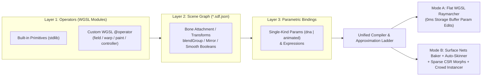

# `fun.dev` — Native WebGPU SDF Modeling, Rigging & Auto-Skinned Mesh Architecture (v3.0)

> **Status (2026-11-05): design roadmap, mostly not built.** What ships today is narrower:
>
> - `/` raymarches one hand-written WGSL scene (`site/scenes/bath-duck.js`) with
>   `site/kernel/runtime.js` ("Mode A"): flat WGSL codegen, uniform substeps, GPU picking,
>   `device.lost` recovery and loop guards (`site/kernel/compiler.js`) are implemented.
> - `/studio` edits the same duck as SDF blocks (`site/kernel/sdf-editor.js`): smooth union and
>   subtraction within groups, mirror X, Surface Nets meshing per group with relaxation, baked
>   AO, a 36-instance crowd, and glTF / JSON / WGSL export, drawn by WebGPU or WebGL2.
> - Not built: skeletons and bone attachment, auto-skinning, the `@operator` protocol and its
>   Lipschitz audit, `dna` / `animated` parameters, the L0–L5 approximation ladder, CSR morphs,
>   skinned glTF export and the A/B deviation budget. Read the sections below as the plan.

## 0. Product Positioning & Dual-Mode Runtime Contract

To scale from single-character interactive toys to city-scale procedural worlds on the scale of `slop-newyork` (hundreds of animated pedestrians, vehicles, and props at 60 fps with shadows and long draw distances), the architecture separates **Interactive Authoring (Mode A)** from **Crowd/Runtime Truth (Mode B)** while compiling both from a single unified asset representation:

1. **Mode B (Baked Auto-Skinned + Sparse-Morphed Mesh) is the Runtime Truth**:
   - At runtime in crowd/city scenes, every character and vehicle renders as an instanced, GPU-skinned triangle mesh extracted via deterministic **Surface Nets**, weighted to a hierarchical skeleton via **4-Bone Distance-Field Auto-Skinning**, and varied across instances via **Parametric Rest-Rig Transforms + Sparse CSR Morph Deltas + Bone-Space Procedural Paint**.
   - Standard export target: **glTF 2.0 Skinned Mesh** (`JOINTS_0`, `WEIGHTS_0` `u8x4` summing to 255, inverse bind matrices) plus a compact **TSL / WebGPU Storage-Buffer Instanced Skinning** module.
2. **Mode A (Flat-WGSL Raymarching) is the Real-Time Sculpting & Inspection Tool**:
   - Used for single-asset sculpting, boolean/smooth-union tuning, gizmo manipulation, and 3D picking.
   - Because Mode A re-evaluates `opSmoothUnion` in posed space while Mode B applies Linear Blend / Dual-Quaternion Skinning (LBS/DQS) to the bind-pose mesh, Mode A provides an instant **"Skinned Mesh Overlay / Toggle"** and enforces a quantitative **A/B Joint Deviation Budget** ($< 1.5$ voxels across standard Range-of-Motion test poses).
3. **Preserved v2.1 Kernel Foundation**:
   - Retains zero runtime dependencies (`navigator.gpu`), `device.lost` recovery + 45-frame TDR rollback guard, dynamic uniform substepping (`hasDynamicOffset: true`), 1-thread GPU raymarch picking with non-blocking `mapAsync` readback, loop trip-count guards, and derivative-free analytical shading (`t * u.pixelAngle`).

---

## 1. Unified Three-Layer Authoring Architecture (WGSL Operators + Scene Graph + Parametric Bindings)

Instead of splitting "visual node graphs" and "handwritten WGSL" into separate systems, `fun.dev` unifies them like Houdini (VEX operators + SOP node graphs). Both built-in primitives and custom user shaders follow the exact same **Operator Protocol** and compile into a single flat WGSL intermediate representation (IR).



### 1.1 Division of Responsibility

| Visual Graph & 3D Viewport Gizmos (Spatial & Structural) | Handwritten WGSL `@operator` Modules (Mathematical & Algorithmic) |
| :--- | :--- |
| 3D placement, rotation, scale, and bone parenting | Custom parametric primitives (gears, threads, splines, fractals) |
| Skeleton hierarchy, joint rest positions, and IK targets | Surface displacement, flutes, scales, and procedural noise |
| `blendGroup` isolation, `smin` radius $k$, and boolean order | Bone-local procedural decals/paint (stripes, windows, wear) |
| Mirror (`mirror: "x"`) and finite array modifiers | Procedural gait, 2-bone IK, and physics/water controllers |
| Palette slots, contrast rules, and parameter range wiring | Custom domain warps (`warp`) and vertex soft-body deformers |

### 1.2 The WGSL `@operator` Module Protocol

Because the WGSL validator rejects raw `@` attributes in user code to prevent binding/entrypoint spoofing, operator metadata is declared in structured `///` doc-comments:

```wgsl
/// @operator crestedFin  role: field
/// @param length    f32 = 0.18 in [0.05, 0.40]
/// @param thickness f32 = 0.03 in [0.01, 0.08]
/// @param waveAmp   f32 = 0.01 in [0.00, 0.04]
/// @lipschitz 1.35
fn field(p: vec3f, length: f32, thickness: f32, waveAmp: f32) -> f32 {
  var q = p;
  q.y -= sin(clamp(q.z / max(length, 1e-4), -1.0, 1.0) * 3.14159) * waveAmp;
  return sdRoundBox(q, vec3f(thickness, thickness * 1.8, length), thickness * 0.6);
}

fn bounds(length: f32, thickness: f32, waveAmp: f32) -> vec3f {
  let pad = thickness + waveAmp + 0.01;
  return vec3f(pad, thickness * 2.8 + waveAmp, length + pad);
}
```

#### Operator Roles & Signatures

| Role | Signature | Mode A (Raymarch) | Mode B (Baked Mesh & Crowd) |
| :--- | :--- | :--- | :--- |
| `field` | `(p: vec3f, ...params) -> f32` | Raymarching & GPU picking | Surface Nets baking, normal-ray morph projection, residual audit |
| `warp` | `(p: vec3f, ...params) -> vec3f` | Domain warp (step divided by $L$) | Evaluated during baking & morph projection |
| `distmod` | `(d: f32, p: vec3f, ...params) -> f32` | Distance modifier (step divided by $L$) | Evaluated during baking & morph projection |
| `paint` | `(s: SurfaceCtx, ...params) -> Material` | Fragment shader (inverse-skinned hit) | Mesh fragment shader (interpolated bind-space `restPos`) |
| `controller` | `(bone: u32, c: CtrlCtx) -> BonePose` | Compute pass writing `Pose` buffer | Shared single Compute pass across Mode A & Mode B |
| `deformer` | `(rest: vec3f, skinned: vec3f, ...params) -> vec3f` | Diagnostic warning (or $p - f(p)$ 1st-order warp preview) | Vertex shader closed-form displacement (e.g. Kelvinlet grab) |

#### Protocol Invariants
1. **Explicit Parameter Arguments**: Parameters are passed as explicit function arguments (`fn field(p: vec3f, ...)`), never read from globals. This allows the baker to evaluate $d(p, \theta \pm \Delta\theta)$ on any parameter vector $\theta$ just by swapping the parameter buffer.
2. **Pure `field` Evaluation**: `field` functions must be pure functions of `(p, ...params)`.
3. **Mandatory `bounds(...params) -> vec3f`**: Returns the local half-extents AABB. Used for:
   - Per-node AABB early-out and 16×16 screen-tile culling in Mode A;
   - Surface Nets voxel grid sizing in Mode B;
   - Localized active vertex region $R(n)$ for Sparse CSR Morphs and L5 island splitting.
4. **Audited `@lipschitz`**: Declares the gradient magnitude bound $L \ge \|\nabla d\|$. An automated audit samples $\|\nabla d\|$ across random points in `bounds()` and flags any operator where $\|\nabla d\| > L$.
5. **v2.1 Scene Isomorphism**: Existing v2.1 single-file scenes (`rubber-duck`, `bath-duck`, `kinetic-flock`, `procedural-walker`) are represented as a single-node graph wrapping a custom operator module.

### 1.3 Why Flat WGSL Codegen + Storage Buffer Beats a Bytecode Interpreter

- **0 ms Parameter & Gizmo Edits**: All node transforms (`rows`), primitive parameters, and blend radii live in a GPU Storage Buffer (`NodeParamsBuffer`). Dragging a 3D gizmo, scrubbing a trait slider, or tweaking colors writes solely to the storage buffer with **zero shader recompilation**.
- **Async Background Recompile on Structural Edits**: Adding/removing nodes or changing `static` topology parameters emits flat, inlined WGSL (which runs 1.5–3× faster than a stack-machine interpreter and natively inlines custom WGSL `@operator` code). The new pipeline compiles asynchronously via `device.createRenderPipelineAsync` while the previous pipeline continues rendering without dropping a frame.

---

## 2. Single-Kind Parametric DNA & Automatic Approximation Ladder (L0–L5)

Authors never manually classify traits into `offset / boneScale / variant`. Every parameter is declared uniformly:

```jsonc
"params": {
  "beakLen":      { "default": 0.18, "min": 0.10, "max": 0.28, "kind": "dna" },
  "neckSeamK":    { "default": 0.08, "min": 0.02, "max": 0.14, "kind": "dna" },
  "tailFinThick": { "default": 0.04, "min": 0.015, "max": 0.08, "kind": "dna" },
  "breathe":      { "default": 0.0,  "min": -1.0, "max": 1.0,  "kind": "animated" }
}
```

- `dna`: Constant per spawned instance (e.g. body girth, beak length, wheelbase).
- `animated`: Time-varying per frame (e.g. breathing, squash, expression).
- `static`: Explicitly discrete topological switch (e.g. number of gear teeth).

### 2.1 The Compiler's Automatic Approximation Ladder

Using the SDF field $d(x, \theta)$ itself as the ground-truth verifier, the baker evaluates each parameter from the cheapest representation upward until the two-sided surface residual falls below tolerance $\varepsilon$ (default $\varepsilon = 0.25 \cdot \text{voxelSize}$):

| Level | Representation | Per-Instance Cost | Automatic Promotion Criterion |
| :--- | :--- | :--- | :--- |
| **L0** | **Material / Paint Only** | 1 `f32` in instance buffer | Static dependency graph shows parameter only reaches `paint` nodes |
| **L1** | **Rigid / Bone Rest Transform** | Per-instance rigid translation / bone rest offset | Parameter only translates nodes or bone rest offsets (`!touchesNodeScale && !touchesNodeRotate`), and `smin` seam residual $\le \varepsilon$ |
| **L2** | **Linear Sparse CSR Morph** | 2 endpoint sparse $\Delta$ columns (`min`, `max` relative to $\theta_{\text{mid}}$, 10 B/entry) | Linear morph from $\theta_{\text{mid}}$ satisfies residual $\le \varepsilon$ at both endpoints (`min`, `max`) and midpoints (`Q25`, `Q75`) |
| **L3** | **Piecewise Multi-Keyframe CSR Morph** | 4 sparse $\Delta$ columns (`min`, `q25`, `q75`, `max` captured along the single continuation path) | L2 midpoint residual $> \varepsilon$, while 4-keyframe piecewise morph satisfies residual $\le \varepsilon$ across all 4 sub-segment midpoints ($\theta_{1/8}, \theta_{3/8}, \theta_{5/8}, \theta_{7/8}$) with valid triangle quality |
| **L4** | **Sparse Pairwise Combination Morph** | Sparse corrective $\Delta_{ij}$ on overlapping `seedMask` vertices | Two parameters $(i, j)$ have overlapping active vertices and their simultaneous extremum residual in any of the 4 quadrants `(min/max, min/max)` exceeds $\varepsilon$ |
| **L5** | **Localized Island Archetype Split** | Separate mesh island for affected `blendGroup`s | Parameter is `static`, L3 residual exceeds budget, or causes triangle stretch $> 2.0\times$ / normal flip / triangle collapse (animated parameters cannot promote to L5) |

### 2.2 Restricted 1D Normal-Ray Root-Finding with Continuation (Fixing Concave & Thin-Sheet Projection)

By the implicit function theorem, differentiating $d(x(\theta), \theta) = 0$ with respect to $\theta$ yields only the normal velocity $\dot{x}_n = -(\partial d / \partial \theta) / \|\nabla d\|$; the tangential reparameterization is unconstrained.

Naive closest-point Newton projection ($v \leftarrow v - d(v)\nabla d(v)/\|\nabla d(v)\|^2$) fails in two common cases:
1. **Concave `smin` seams / medial axes**: Closest-point projection is discontinuous across the medial axis, causing vertices to jump across creases or collapse onto a single point.
2. **Thin sheets (ears, fins, spoilers)**: When $|\Delta \theta|$ is large relative to sheet thickness, unconstrained gradient steps cross the medial plane and snap onto the opposite face of the thin sheet.

**Solution**:
1. **Median Base Bake**: Always bake the base mesh $V_0$ at the parameter midpoint $\theta_{\text{mid}} = \frac{1}{2}(\theta_{\min} + \theta_{\max})$, halving maximum displacement.
2. **Homotopy Continuation ($M = 6$ substeps)**: Step $\theta$ incrementally from $\theta_{\text{mid}}$ to $\theta_{\text{key}}$ in $M$ steps, capturing the halfway snapshot (`Q25` or `Q75`) at step $M/2$.
3. **Restricted 1D Root-Finding Along Current Normal $n$**:
   - At each continuation step, estimate local medial depth $r_{\text{medial}}$ by probing $d_{\text{group}}(v - s \cdot n)$ inward along $-n$, and clamp the search interval to $s \in [-r_{\text{max}}, +r_{\text{max}}]$ where $r_{\text{max}} = \min(0.80 \cdot r_{\text{medial}}, 1.5 \cdot \text{voxelSize})$.
   - Bracket the zero-crossing of $f(s) = d_{\text{group}}(v + s \cdot n, \theta_m)$ within $[-r_{\text{max}}, +r_{\text{max}}]$ keeping the same sign orientation ($n \cdot \nabla d_{\text{group}} > 0$), then refine with 6 iterations of safeguarded secant/bisection.
   - Only if the surface tilted nearly orthogonal to $n$ (no bracket in $[-r_{\text{max}}, +r_{\text{max}}]$) does it fall back to a step-clamped damped Newton step, followed by 5 passes of tangential edge-length-weighted Laplacian relaxation + normal re-projection.
4. **`blendGroup` Confinement**: Projection always evaluates $d_{\text{group}}(x, \theta)$ of the vertex's own `blendGroup`, preventing arm vertices from projecting onto the torso.

### 2.3 Two-Sided Residual & Topological Verification

To verify whether level $L_k$ suffices at sample parameter $\theta$:
- **Forward Residual (Mesh-to-SDF)**: $\max_{v \in R} |d_{\text{group}}(v_{\text{morph}}(\theta), \theta)| \le \varepsilon$.
- **Reverse Coverage & Quality Guard (SDF-to-Mesh)**:
  - Softened triangle edge stretch ratio $\le 2.0$ and un-softened edge collapse guard ($l_0 > 0.15h \implies l_1 \ge 0.15 l_0$);
  - Vertex normal vs SDF gradient angle $\arccos(n_{\text{morph}} \cdot \hat{\nabla} d) \le 25^\circ$;
  - Topological invariant check: Manifoldness (`isManifold`), Euler characteristic $\chi = V - E + F$, and connected component count of a verification Surface Nets pass at $\theta$ (at bake `voxelSize`) must match $\theta_{\text{mid}}$. If topology changes, the parameter automatically promotes to **L5**.

---

## 3. Posed SDF vs Skinned Mesh, `blendGroup` Isolation & Auto-Skinning

### 3.1 Rigid Per-Node Posed SDF (No Space-Folding Inverse Matrix Blending)
- Never deform the raymarch query point by a linear combination of inverse bone matrices ($\sum w_i M_i^{-1} p$), which is non-isometric and folds space.
- Instead, each primitive transforms rigidly with its single parent bone ($p_{\text{local}} = T_{\text{prim}}^{-1} T_{\text{bone,posed}}^{-1} p$), and `opSmoothUnion` blends across joints inside the same `blendGroup`.
- Compile-time `mirror: "x"` expands into two distinct primitive nodes bound to symmetric bones (`upperArm.L` and `upperArm.R`) and marks the mirrored twin as a read-only ghost node in the scene tree.

### 3.2 `blendGroup` Isolation
- Smooth union (`smin`) only blends nodes sharing the same `blendGroup` (e.g., `body`, `legL`, `legR`, `wheelFL`). Different groups combine via hard `min`.
- Surface Nets extracts each `blendGroup` as an independent manifold island so close limbs (like inner thighs in bind pose or hands passing the hips) never web together.

### 3.3 Deterministic Surface Nets & 4-Bone Auto-Skinning
1. **Deterministic Surface Nets**:
   - Evaluates bind-pose SDF on $(N_x+1)(N_y+1)(N_z+1)$ grid corners with a 2-voxel border pad.
   - Classifies active cells ($0 < \text{mask} < 255$) and assigns deterministic vertex indices via **prefix-sum scan** (never non-deterministic `atomicAdd`).
   - Computes average edge zero-crossing, applies 2 steps of cell-clamped Newton projection ($p \leftarrow p - d\nabla d / \|\nabla d\|^2$, clamped within cell $\pm 0.5$ voxel), and splits each quad along the diagonal whose midpoint has smaller $|d|$.
2. **4-Bone Distance-Field Auto-Skinning**:
   - Evaluates per-bone SDF $d_b(v)$ within the vertex's `blendGroup` (excluding right-hand operands of `SmoothSubtract` / `SmoothIntersect`).
   - Restricts candidate bones to within **2 skeleton graph hops** ($\text{hops}(b, b^*) \le 2$) of the closest bone $b^* = \arg\min_b d_b(v)$.
   - Uses an independent joint transition width $w = \max(k, 0.15 \cdot L_{\text{bone}})$:
     $$\text{raw}_b(v) = \left(1 - \text{clamp}\left(\frac{d_b(v) - d_{b^*}(v)}{w}, 0, 1\right)\right)^2$$
   - Locks `rigid: true` parts to weight `1.0`, runs 4 iterations of Jacobi Laplacian smoothing along mesh edges, selects top-4 bones, and quantizes to `u8x4` summing strictly to `255` via the Largest Remainder Method.
   - For crowd instances, static `dna` CSR morph deltas are resolved once into the instance's rest mesh (or pre-skinned vertex stream) so the per-frame vertex shader only executes standard 4-bone skinning.
